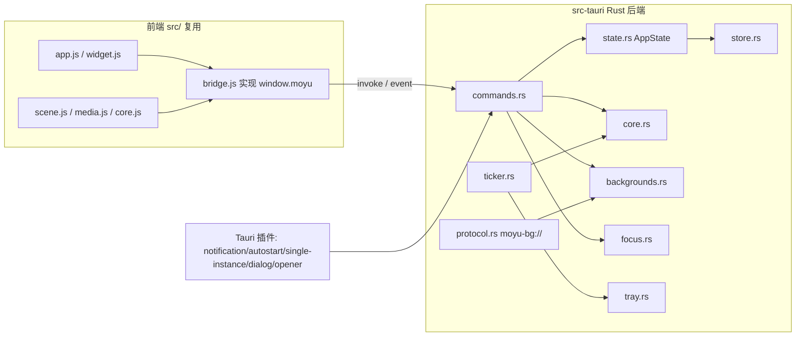

## 产品概述

将桌面工具「摸鱼小狐」从 Electron 45 迁移到 Tauri 2.x。保持全部既有功能、视觉样式与交互不变，复用现有 HTML/CSS/JS 前端，仅用 Rust 重写主进程与系统集成，把安装包从约 100 MB 降至约 10 MB。数据采用新目录重新开始，不迁移旧 Electron 配置。

## 核心功能

- 下班倒计时、今日实时收入、休息日/大小周/发薪日计算，全部逻辑与显示口径保持一致
- 桌面小组件：无边框透明置顶窗口，可拖动、四档大小、双击打开主界面、右键菜单
- 托盘/菜单栏：mac 菜单栏显示倒计时，Windows 托盘悬停显示状态，菜单可切换各项开关
- 专注识别：mac/Windows 前台软件识别，专注/摸鱼/离开/加班统计，近 7 天趋势
- 自定义背景：图片/GIF/视频导入，格式嗅探、内容去重、缩略图、视频循环播放
- 系统通知（上班/下班前 10 分钟/下班提醒）、开机自启、单实例、升级检测与更新日志
- 老用户数据不迁移，Tauri 使用独立的新数据目录

## 技术栈

- 前端：现有 `src/` 全部 HTML/CSS/JS 原样复用（SVG 场景与 CSS 动画跑在系统 WebView，无需改动）
- 后端：Rust + Tauri 2.x（稳定版），`cargo` / `tauri-cli` 构建
- 插件：`tauri-plugin-notification`（通知）、`tauri-plugin-autostart`（开机自启）、`tauri-plugin-single-instance`（单实例）、`tauri-plugin-dialog`（文件选择）、`tauri-plugin-opener`（打开外部链接/数据目录）
- 关键 crate：`serde`/`serde_json`、`chrono`、`sha2`、`windows`（Win32）、`core-graphics`/`core-foundation`（mac 空闲检测）
- 打包目标：macOS `dmg`（arm64 + x64）、Windows `nsis`（x64）

## 实现方案

### 总体策略

保留前端渲染层不动，把 Electron 主进程（`main/*.js`，约 1800 行）翻译为 Rust 模块；新增一个 `bridge.js` 按现有 `window.moyu` 接口封装 Tauri 的 `invoke`/`event`，使 `app.js`、`widget.js` 几乎零改动。核心收益是 SVG 场景、CSS 动画、设置表单全部不用重画。

### 关键决策

1. **前端桥接用 `window.__TAURI__` 全局注入而非 npm 依赖**：在 `tauri.conf.json` 开启 `app.withGlobalTauri: true`，`bridge.js` 直接调用 `window.__TAURI__.core.invoke` 和 `window.__TAURI__.event.listen`。前端保持无构建工具、无 node_modules。
2. **核心逻辑双实现**：托盘倒计时文字、通知文案需在 Rust 侧每秒计算，因此把 `core.js` 复刻为 `core.rs`；前端 UI 仍用 `core.js`。两者通过共享的「固定时间点 + 配置快照」测试夹具比对输出，保证口径一致。
3. **自定义协议**：`moyu-bg://` 用 Tauri v2 `register_uri_scheme_protocol` 实现，保留 `Range` 支持（视频循环与拖动必需），只读且带格式校验。
4. **专注识别**：mac 沿用 `lsappinfo` 轮询（行为最稳、零权限）；Windows 用 `windows` crate 直接调用 `GetForegroundWindow` + `GetWindowThreadProcessId` + `QueryFullProcessImageNameW`，替换现有 PowerShell hack。空闲/锁屏用系统 API（mac `CGEventSourceSecondsSinceLastEventType`，win `GetLastInputInfo`）。
5. **数据目录**：Tauri 默认 `app_data_dir` 基于 identifier `com.moyufox.desktop`，与 Electron 的「摸鱼小狐」目录天然分离，满足「新目录、不迁移」。
6. **窗口**：主窗口 macOS 隐藏标题栏保留红绿灯、Windows `titleBarOverlay`；小组件窗口 frameless + transparent + alwaysOnTop + skipTaskbar，拖动改用 Tauri `startDragging`。
7. **打包分工**：mac 包在 macOS 本机打；Windows 包用 Windows 本机或 CI（跨平台编译 WebView2/NSIS 成本高，不推荐 mac 交叉编译）。

## 架构设计



### 模块职责

- `state.rs`：`Arc<Mutex<AppStateInner>>` 持有 Store、Backgrounds、FocusTracker、窗口句柄；提供命令与后台线程共享的可变状态
- `store.rs`：`config.json` 分区存储，移植 `store.js`（默认值合并、未知分区保留、临时文件 + rename 原子写）
- `core.rs`：移植 `core.js`（日期工具、休息日、工时薪资、snapshot/describe、格式化）
- `backgrounds.rs`：素材库，移植 `backgrounds.js`（嗅探、哈希去重、复制、缩略图）
- `focus.rs`：前台软件监听 + 按天统计，移植 `focus.js`
- `tray.rs`：托盘/菜单栏构建与文字更新
- `ticker.rs`：每秒心跳线程，计算快照、更新托盘、触发通知、发送专注实时事件
- `protocol.rs`：`moyu-bg://` 只读协议，支持 Range
- `commands.rs`：`#[tauri::command]` 处理器，1:1 对应 `preload.js` 暴露的 IPC 全集
- `events.rs`：`work:changed` / `app:changed` / `look:changed` / `focus:live` / `focus:config` 事件发射

### 数据流

渲染进程调用 `bridge.js` → `invoke(command)` → `commands.rs` 读写 `AppState` → 返回结果；后台 `ticker.rs` 每秒计算并 `emit` 事件 → `bridge.js` 分发到 `app.js`/`widget.js` 的回调，复用现有前端逻辑。

## 实现要点（执行细节）

### 性能

- 每秒 ticker 只做 O(1) 快照计算；镜像现有 `lastTrayText`/`lastFocusPayload` 去重，值不变不 emit，避免无谓的前端重渲染
- `moyu-bg://` 协议用流式 Range 响应，不把大文件整体读入内存
- Store 写入沿用 200ms 防抖 + 30s 专注统计 flush，避免频繁磁盘 IO
- 前台软件轮询维持现有 1.5s 间隔，`focus.rs` 的 shell 调用需带超时与失败重试，避免僵尸进程

### 一致性与回归

- 建立 `core` 测试夹具：对固定 `Date` + 多组 work 配置断言 `core.rs` 与 `core.js` 输出一致（snapshot 状态、countdown、earned、describe 文案）
- `bridge.js` 严格保持 `preload.js` 的方法名与返回结构，前端逻辑不改动即为回归安全

### 日志与错误处理

- 复用 Tauri 的 `log` 宏 + `tauri-plugin-log`（可选），错误分级输出；专注识别失败不崩溃，仅置错误状态回传前端
- 协议 404/400/416 返回标准 HTTP 状态，与 `backgrounds.js` 现有行为一致
- 不记录窗口内容、网址或用户隐私，日志仅含软件名与错误信息

### 爆炸半径控制

- 在 `src-tauri/` 新增 Rust 工程，保留现有 Electron 代码不删除，直到 Tauri 版验证通过再清理
- 前端仅在两处 HTML 末尾新增 `bridge.js` 脚本引用（在 `app.js`/`widget.js` 之前），其余 `src/` 文件零改动
- `index.html` 中 `../assets/icon.png` 的关于页图标引用需随前端目录结构一并处理（把 `assets/` 复制进 Tauri `frontendDist` 或调整路径）
- CSP 中 `moyu-bg:` 的 `img-src`/`media-src` 声明保留，与协议注册配套

## 目录结构

```
MoyuFox/
├── src-tauri/                     # [NEW] Rust 后端工程
│   ├── Cargo.toml                 # 依赖与插件声明
│   ├── tauri.conf.json            # 窗口/identifier/withGlobalTauri/打包/bundle 配置
│   ├── build.rs                   # tauri_build::build()
│   ├── icons/                     # 应用图标（复用 build/icon.icns、icon.ico 生成）
│   └── src/
│       ├── main.rs                # 入口：初始化插件、注册协议、启动 ticker
│       ├── lib.rs                 # 模块导出与 tauri::generate_context! 供命令注册
│       ├── state.rs               # AppState 与共享可变状态
│       ├── store.rs               # config.json 分区存储（移植 store.js）
│       ├── core.rs                # 计算核心（移植 core.js）
│       ├── backgrounds.rs         # 素材库（移植 backgrounds.js）
│       ├── focus.rs               # 前台软件识别与统计（移植 focus.js）
│       ├── tray.rs                # 托盘/菜单栏
│       ├── ticker.rs              # 每秒心跳
│       ├── protocol.rs            # moyu-bg:// 协议（含 Range）
│       ├── commands.rs            # Tauri command 处理器
│       └── events.rs              # 事件名与 emit 辅助
├── src/
│   ├── js/
│   │   └── bridge.js              # [NEW] 封装 window.__TAURI__ 为 window.moyu
│   ├── index.html                 # [MODIFY] 末尾在 app.js 前引入 bridge.js
│   └── widget.html                # [MODIFY] 末尾在 widget.js 前引入 bridge.js
└── assets/                        # [保留] 托盘/窗口运行时图标
```

现有 `main/`、`scripts/`、`package.json`（electron-builder 部分）在 Tauri 版验证通过后再清理；`src/js/core.js`、`scene.js`、`media.js`、`app.js`、`widget.js` 与全部 CSS 均保持不动。